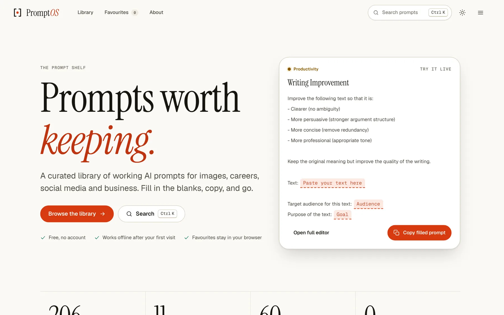
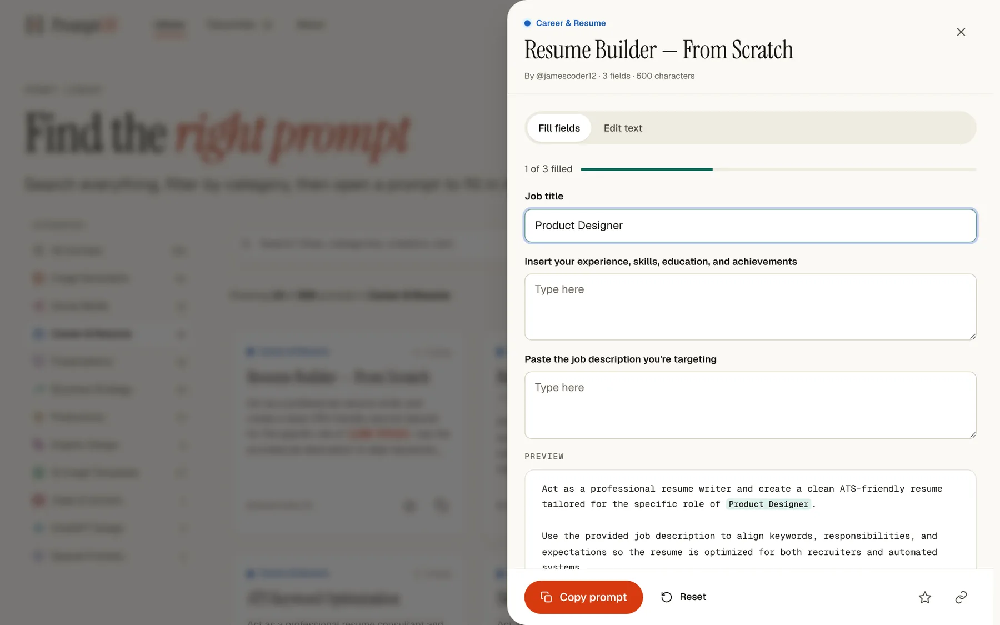
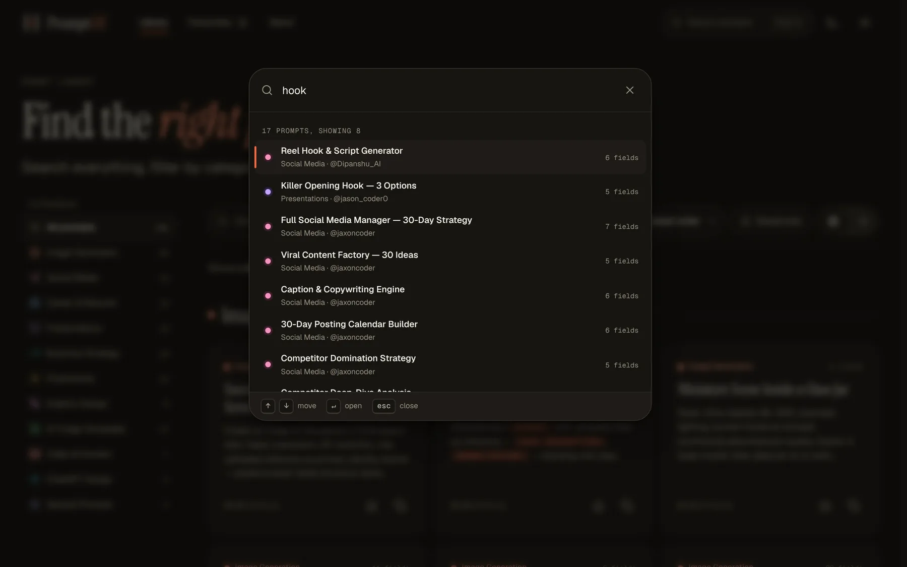

<p align="center">
  <picture>
    <source media="(prefers-color-scheme: dark)" srcset="docs/assets/logo-dark.png">
    
  </picture>
</p>

<p align="center"><strong>Prompts worth keeping.</strong><br>A curated library of working AI prompts. Fill in the blanks, copy, and go.</p>

<p align="center">
  <a href="https://github.com/babatundeawo/ai-prompt-library/actions/workflows/deploy.yml"></a>
  <a href="https://github.com/babatundeawo/ai-prompt-library/actions/workflows/codeql.yml"></a>
  <a href="https://babatundeawo.github.io/ai-prompt-library/"></a>
</p>

<p align="center">
  <a href="https://babatundeawo.github.io/ai-prompt-library/"><strong>Live site</strong></a> ·
  <a href="https://babatundeawo.github.io/ai-prompt-library/about.html">About and shortcuts</a> ·
  <a href="https://github.com/babatundeawo/ai-prompt-library/issues/new/choose">Report an issue</a>
</p>

<p align="center">
  
</p>

## About

PromptOS is a free prompt library for people who use AI image generators and chat assistants every day. It collects over 200 prompts for image generation, careers, social media, presentations, business strategy and more, each credited to its creator. Every prompt marks its blanks in square brackets, and PromptOS turns those blanks into inputs so you can finish a prompt in seconds instead of editing text by hand.

## Features

- **Fill-in-the-blank prompts.** Each `[FIELD]` becomes a labelled input with a live preview. Prefer your own wording? Switch to *Edit text*.
- **Command palette.** Press `Ctrl` + `K` (`⌘` + `K` on Mac) on any page to search every prompt, jump to a category, or switch theme.
- **Library page.** Search, filter by category, sort, and switch between grid and list. Every view has a shareable link.
- **Favourites.** Star the prompts you reuse. They stay in your browser and sync between tabs.
- **Light and dark themes.** Follows your system setting, or choose with the toggle.
- **Works offline.** After your first visit the library is stored on your device. Install it from your browser's menu to open it like an app.
- **Private by design.** No account, no cookies, no analytics.

<p align="center">
  
</p>

## How to use it

1. **Find a prompt.** Browse a category on the home page, open the [library](https://babatundeawo.github.io/ai-prompt-library/library.html), or press `Ctrl` + `K` and type a few words.
2. **Open it and fill in the fields.** Type into each input and watch the preview update.
3. **Copy.** Press *Copy prompt* (or `Ctrl` + `Enter`) and paste it into your AI tool.

Tip: use the link button inside a prompt to share it with someone.

<p align="center">
  
</p>

## Tech stack

- Plain HTML, CSS and JavaScript. No framework and no build step.
- [Instrument Serif](https://github.com/Instrument/instrument-serif), [Geist](https://github.com/vercel/geist-font) and Geist Mono, self-hosted.
- A service worker and web manifest for offline use and installation.
- GitHub Actions and GitHub Pages for checks and hosting.

## Project structure

```
.
├── index.html, library.html, favorites.html, about.html, 404.html   Pages
├── css/          Design tokens, base styles, layout, components, page styles
├── js/           data.js (all prompts) plus small scripts for each feature
├── assets/       Self-hosted fonts, icons and the social preview image
├── docs/         Guides for maintainers and screenshots
├── scripts/      Checks that run automatically on every change
├── sw.js         Service worker (offline support)
└── .github/      Workflows, issue templates and dependency updates
```

## Contributing

Found a bug or have a prompt to suggest? [Open an issue](https://github.com/babatundeawo/ai-prompt-library/issues/new/choose); the forms walk you through it. To change the site itself, see [CONTRIBUTING.md](CONTRIBUTING.md). Maintainers will find a plain-language guide to publishing in [docs/DEPLOYMENT.md](docs/DEPLOYMENT.md) and one for changing colours, text and images in [docs/CUSTOMIZING.md](docs/CUSTOMIZING.md).

## Security

Please report security problems privately. See [SECURITY.md](SECURITY.md).

## Credits

- Prompts are credited to their creators on each card and on the [About page](https://babatundeawo.github.io/ai-prompt-library/about.html).
- Fonts are licensed under the SIL Open Font License 1.1; the licence texts are in [`assets/fonts`](assets/fonts).
- Maintained by [Babatunde Awoyemi](https://github.com/babatundeawo).
